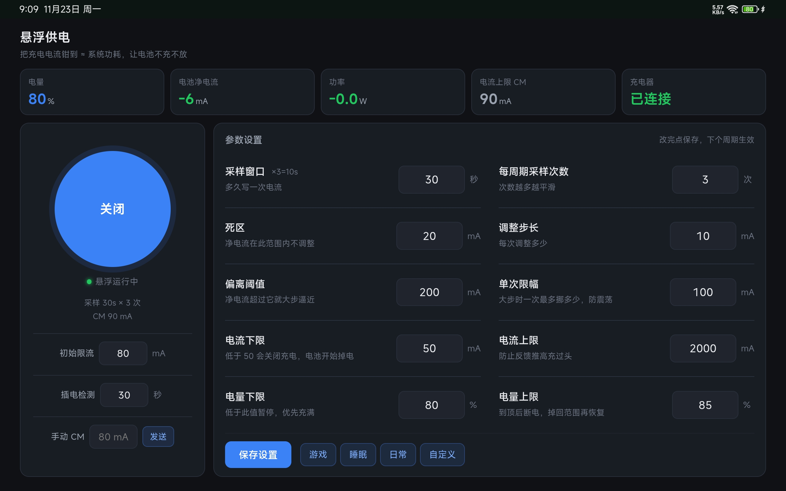

# MiFloatCharge — 悬浮供电

Magisk 模块：把充电电流钳到 ≈ 系统功耗，**让电池不充不放**（净电流 ≈ 0），
功耗全部由适配器承担。电池全程几乎不参与充放电，发热和老化都降到最低。

和"真旁路"不同，它不需要驱动提供旁路位，只靠一个可写的电流上限节点，
**任何暴露 `constant_charge_current_max` 的小米设备理论上都能用**。

- 实测机型：**小米平板 5 Pro**（`M2105K81AC` / `elish` / SM8250 / HyperOS 1.0（OS1.0.2.0.TKYCNXM / Android 13）/ Magisk 30.6）
- 系统：实测 Android 13（HyperOS 1.0.2）/ Magisk 30.6
- Root：**仅 Magisk**（在 Magisk 30.6 上实测）。KernelSU / APatch **未适配**——
  本模块没有它们的安装脚本，也没测试过，**装不上或装上用不了**，请勿尝试
- 模块只有 shell 脚本 + 一个静态网页，**不安装任何 App**
- 图形界面需要**自备 KsuWebUI**（第三方 App，不在本项目内，详见下方"使用"）
- **⚠️ WebUI 界面目前只针对平板调试**，布局/字段是为 elish 这块屏调的；
  在手机上打开**可能严重错位**（不是模块功能问题，只是界面没适配手机屏幕）。
  命令行路径（`bin/float-ctl.sh`）不受影响，任何设备都能用。

> 本人做这个模块是自用，可能因学业原因维护不及时，欢迎提 Issue，但不保证响应时效。

## 更新日志

### v1.2.0（2026-11-24）— 预发行

大功能版本，**直接覆盖安装即可**，配置保留。核心新增**定时切换预设**。

- **定时切换预设**（WebUI 新增「定时切换预设」区，下滑可见）：设进入夜间 / 退出夜间时间，
  在时段内自动用「夜间」预设、时段外用「日常」预设。开关可随时启停；
  到点自动执行，精度约 1 秒，**靠算到边界一次长睡（封顶 1 小时）实现，不轮询、几乎不费电**。
- **预设高亮**：当前参数与某预设完全一致时该标签高亮；手改任一参数即取消高亮。
  长按保存 = 用当前参数覆盖预设并立即执行 + 高亮。
- **总开关联动**：关总开关两个进程（悬浮守护 + 定时）都停；开总开关按配置恢复；
  单独开定时会联动开总开关，避免"定时空转但不限流"的半开状态。
- **写电流周期修正**：之前 `WINDOW=30/COUNT=3` 实际 20s 写一次（漏了最后一次等待），
  现在任何 COUNT 下都严格按 SAMPLE_WINDOW 写。
- **日志增强**：定时裁决/到点切换、到顶断电/恢复、低电量、插拔电等节点都带详细状态与下次切换时间，
  便于回溯；修复时段无前导零（`0:00`）时白天被误判成夜间、切错预设的问题。
- **WebUI**：日志上滑看历史不再被新日志拉回底部；去掉多余的行数显示；
  修首屏打开时的布局抖动；消息提示不再串台。
- **仅支持 Magisk**（KernelSU / APatch 未适配）。

### v1.1.2（2026-11-23）

小改进与稳定性修复，**直接覆盖安装即可**，配置保留。

- **初始化 CM 后保持 60 秒不采样**：从快充切到限流时写 CM 会触发 PD 重新协商、充电断约一分钟，
  这段暂态内采样会误判成大幅偏离、导致 CM 大步波动。现在先保持初始 CM 一分钟，PD 稳定后再采样。
- 保存设置 / 切预设仍会**立即跳过**这 60 秒（用户正等着），且该跳过只对当轮有效——
  避免标志残留到后续真正从快充切入时漏掉保护。
- **修复**：采样过程中切预设要等剩余采样点睡完才生效（COUNT=3 最坏多等 20 秒），
  现在收到信号立即跳出，1 秒内响应。
- 文档：补 WebUI 实测截图，把上述发现写进「原理与实测 / 踩过的坑」和「参数说明」。

### v1.1.1（2026-11-23）

控制逻辑和日志的可维护性更新，**直接覆盖安装即可**，无需卸载、配置保留。
**仅支持 Magisk**（KernelSU / APatch 未适配）。

- **新增「插电检测周期」**（`PLUG_POLL`，默认 30s）：没插电时多久看一次充电器状态，
  界面左侧可调；想插上电立刻响应就调小（如 5~10s）。
- **保存设置 / 切预设立即生效**：不再等当前采样周期结束，daemon 立刻用新参数重开一轮。
- **到顶断电加大迟滞**：到顶断电后要掉到 `BATT_MAX − 2` 才恢复，避免 89↔90 夜间反复横跳。
- **日志改进**：单位 µA 改为 mA（保留一位小数）、净电流符号翻成和界面一致（正=充电）、
  上限提到 9000 行（约 3 天）、界面日志框内滚动并显示最近 200 行、默认停在最新一行。
- **修复**：`SAMPLE_COUNT=1` 时采样周期没有等待、疯狂刷日志的问题；
  抵到电流上下限时 `adj` 归零、不再做无效写入。
- 预设格式末尾增加第 13 列「插电检测周期」（缺列时兼容旧值）。

### v1.1.0（2026-11-21）— 模块更名，需卸载重装

**⚠️ 模块 ID 由 `float_charge` 改为 `MiFloatCharge`**，数据目录同步改为
`/data/adb/MiFloatCharge`。

**升级方法**（模块 ID 变更，等同于全新安装，没有数据需要迁移）：

1. 卸载旧模块 `float_charge`（卸载脚本会自动还原电流上限）
2. 安装本版
3. 重启
4. 重新设置参数——旧版没有预设功能，全部参数也就十来项；
   或者直接点界面上的预设标签套用出厂值（日常 / 夜间 / 游戏 / 固定）

## ⚠️ 测试范围

这个项目是实验性工具，**只在一台设备上验证**，谈不上充分。
在把它用于主力设备前，请先看下面这份清单：

**已测试**

- 小米平板 5 Pro（`elish`），HyperOS，Magisk 30.6
- PD 充电器（65W），有线充电
- 电量 50~94% 区间（含低电量保护线附近、CV 段）
- 单个 CM 档位的长时间稳定性（CM=60mA，连续观察 5~6 分钟；另有**连续多日挂机运行**，
  daemon/定时脚本常驻未出现电流节点被重置或进程悄悄消失）
- 插拔充电器、`start` / `stop` / `toggle` 的往返
- 定时切换预设：进入/退出夜间时段的到点切换、手动改时段后的重裁决，均已实测
- WebUI 只在**已装 KsuWebUI 的同型号设备**上验证过（且界面按平板屏调，手机会错位）；
  纯命令行路径测得更充分

**未测试（没有数据）**

- ❌ 低电量段（<50%）—— 系统功耗和充电曲线都不同，最优 CM 可能完全不是 50~80mA
- ❌ 非 PD 充电器（5V2A 慢充、车载、电脑 USB 口）
- ❌ 无线充电
- ❌ 边玩边充（高负载发热场景）、关机充电
- ❌ **其他机型**——只在 elish 验证过，"理论上可用"不等于"能用"
- ❌ 其他系统版本（Android 12 / 14 / 15）
- ❌ KernelSU / APatch（**本模块未适配**，只有 Magisk 安装脚本）
- ❌ 与其他充电控制类模块/App 共存（Scene、Acc、Battery Charge Limit 等）
- ❌ 对电池寿命的长期影响——**没有数据**，不要相信任何"护电池"的说法

**建议**：第一次用请插着充电器、人在旁边看着；不要设开机自启后就不管。
出问题就 `float-ctl.sh stop`，再不行重启设备。

## 实测：CM 控制曲线

在小米平板 5 Pro 上逐档写入 `constant_charge_current_max`，等稳定后取
`current_now` 平均值（负 = 充电 / 正 = 放电）：

| 写入 CM | 净电流 | 行为 |
|---|---|---|
| 0 | +123 mA | 充电器关闭，系统全靠电池 |
| 20 / 40 / 48 | +99 ~ +119 mA | 同上，设多少都一样 |
| **50** | **−33 mA** | **临界点：开始充电** |
| 52 ~ 60 | −30 ~ −40 mA | 最小充电档，不随设定值变化 |
| 100 | −87 mA | 进入线性区 |
| 200 | −183 mA | |
| 500 | −482 mA | |
| 1000 | −991 mA | |

三个结论：

1. **CM 是连续可控的**，不是云控档位——写入值与 `constant_charge_current` 读数 1:1 一致
2. **临界点在 50 mA**：低于 50 驱动直接关闭充电，电池转为放电
   （这正是"下限设 0、睡一晚掉一格电"的原因）
3. **≥100 才线性**：净电流 ≈ −(CM − 27)，斜率约 −1

所以 `CM下限` 填 **50** 是稳妥默认；允许填更低（包括 **0**），模块不会拦你。
但低于约 40 等于让驱动关闭充电、电池掉电，这是硬件行为，不是模块强制限制。

需要说明的是：把 CM 压到 50 附近，理论上能让电量在夜间保持稳定、几乎不涨，
但实测会**在 50% 附近来回跳动、频繁触发充电/断电**——CM 稍微偏高就开始充、
稍微偏低就转放电，恰好卡在驱动的启停临界点上。而且 CM 一旦压到下限，
即使平衡后的电流仍在死区外，也已经调不下去、只能停在那个微弱充电状态。

### 补充：CM=0 的行为是有条件的

后续实测发现，写 `CM=0` 的结果取决于是**从什么状态写进去的**：

| 写入时的状态 | 写 0 的实际结果 |
|---|---|
| 已经在限流中（CM 较小） | **断电**，转放电 |
| 正在正常快充中（CM 很大） | **无效**，驱动当没设置，继续 4A 快充 |

第二种情况下 `constant_charge_current` 读数显示 0，但电池仍在进 4A——设定值和实际行为脱节。
更可靠的做法是用 `night_charging=1` 停充，模块的"到顶断电"用的就是它。

## 原理

平板的供电拓扑是：**适配器 → 充电 IC → 电池 → 系统负载**（电池与系统并联）。

```
适配器输入 = 系统耗电 + 电池充电电流
电池净电流 = 充电电流 − 系统耗电
```

把 `constant_charge_current_max`（给电池的电流上限）压到约等于系统耗电时：

```
充电电流 ≈ 系统耗电  →  电池净电流 ≈ 0
```

电池既不充也不放，系统功耗全部由适配器直供。

### 实测数据（小米平板5 Pro，PD 充电器，屏幕点亮，系统功耗约 370mA）

| CM 设定 | 电池净电流 | 状态 |
|---|---|---|
| 600 mA 以上 | -4.5 A | 限流失效，仍是满速快充 |
| 300 mA | -268 mA | 正常限流 |
| 150 mA | -114 mA | 正常限流 |
| 100 mA | -63 mA | 接近零点 |
| **50 ~ 80 mA** | **+13 ~ 15 mA** | **悬浮（净电流 ≈ 0）** |
| 40 mA 以下 | +310 mA | 滑入断充（驱动放弃充电） |

**注意死区**：CM 低于约 40mA 时，驱动会判定"这点电流不值得充"而直接放弃，
电池反而开始放电（+310mA）。模块提供 `MIN_CM_MA` 参数来钳住算法的输出下限，
**默认 50mA，但可以改成 0**；改成 0 时模块允许把 CM 一路写到 0，
低电流下的断充/掉电是驱动行为，不是模块额外加的限制。

### 稳定性

CM 设 60mA 后连续采样 30 秒：

```
净电流: +15, +17, +17, +17, +17, +15, +15, +13, +13, +13 mA
输入:   390, 238, 305, 323, 248, 310, 256, 279, 345, 270 mA
电压:   5.10V（稳定）
电量:   91%（纹丝不动）
```

净电流波动在 ±2mA 内，电量 30 秒没有变化。持续观察 5~6 分钟，
电流上限**没有被系统重置**（该节点不属于 HAL 管理范围，没有服务回写它）。

## 为什么不用官方接口

小米充电 HAL（`vendor.xiaomi.hardware.micharge`）的完整可写路径清单里，
**没有 `constant_charge_current` 或 `constant_charge_current_max`**：

```
battery/charge_control_limit   ← PD 电压档位
battery/input_suspend          ← 断输入
battery/night_charging         ← 限充开关
battery/smart_batt
qcom-battery/{input_suspend, night_charging, cool_mode, power_max}
```

HAL 方法也只有 `setMiChargePath` / `setNightChargingState` /
`setInputSuspendState` / `setCoolModeState`，**没有 `setCurrent`**。

所以官方能力上限只是"到 80% 断充"，做不到任意电流限流。
本模块和 Scene 的充电调速一样，都是**绕过 HAL 直接写 sysfs**。

## 目录

```
module/                    模块本体（可直接打包成 zip 刷入）
  module.prop              模块信息
  config.conf              参数配置（运行时会被 daemon 周期重读）
  service.sh               开机自启（ENABLED=0 时直接退出，不占资源）
  action.sh                Magisk「操作」按钮：装了 KsuWebUI 就打开图形界面，否则退回命令行切换
  uninstall.sh             卸载时还原电流上限，避免留下"一直限流"
  bin/float-daemon.sh      守护主循环：采样 → 求平均 → 增量调整 → 写节点
  bin/float-ctl.sh         控制接口：start / stop / toggle / status
  webroot/index.html       WebUI 单页（HTML 内联 JS，无外链）

docs/
  参数说明.md              每个参数的详细说明、常见调法、日志读法
  原理与实测.md            机制分析、官方接口调研、完整实测数据
  test.sh                  回归测试脚本（可逆，跑完自动还原）

build.sh                   打包：读 module/module.prop 版本号，生成 MiFloatCharge-v<版本>.zip
```

## 安装

1. 下载 `MiFloatCharge-v*.zip`
2. Magisk App → 模块 → 从本地安装
3. 重启

模块默认 `ENABLED=0`，**装完不会自动生效**，需要手动开启。

## 使用

### 图形界面（推荐，但需要额外装一个 App）

**先说清楚：本模块不自带 WebUI 容器，也不安装任何 App。**

模块里只有一个 `webroot/index.html` 静态页面，它需要一个"容器"App 来加载。
这个容器就是 **KsuWebUI**（包名 `io.github.a13e300.ksuwebui`）——一个**第三方独立 App**，
不是本项目的组成部分，也不随本模块安装。

> 它是 KernelSU 生态的工具，但只是通过 `su` 执行命令，所以 **Magisk 上也能跑**——
> 这只关系到那个 App 本身，和本模块支持的 root 方案无关。
> 很多"横屏适配""模块管理"类模块会顺手把它装上，所以你可能已经有了；
> 但如果你的设备上没有，**图形界面就打不开**。

**怎么确认有没有**：设置里找 "KsuWebUI" 这个 App，或者执行

```sh
pm list packages | grep io.github.a13e300.ksuwebui
```

有输出就是装了。

**装了之后**：点模块卡片的「操作」按钮会直接打开图形界面：

- 大圆按钮一键开关
- 实时显示电量 / 电池净电流 / 电流上限 / 充电器状态
- 参数可视化调整，改完点保存
- 底部运行日志（首屏不显示，往上滑查看）

界面实测（小米平板 5 Pro / 横屏）：



**没装也不要紧**：`action.sh` 会自动退化成命令行切换（点一下开 / 再点一下关），
所有功能都能用，只是没有图形界面。

> 本项目不包含 KsuWebUI 的 APK，也不对它做任何分发或背书。
> 需要的请自行搜索该包名获取（它的源码在 GitHub 上），安装后记得给它 root 权限。

### 命令行

```sh
# 开关
sh /data/adb/modules/MiFloatCharge/bin/float-ctl.sh start
sh /data/adb/modules/MiFloatCharge/bin/float-ctl.sh stop
sh /data/adb/modules/MiFloatCharge/bin/float-ctl.sh toggle
sh /data/adb/modules/MiFloatCharge/bin/float-ctl.sh status

# 看日志
tail -50 /data/adb/MiFloatCharge/float.log
```

### 预设（一键切换参数）

界面底部有 5 个标签：**日常 / 夜间 / 游戏 / 固定 / 自定义**。

**固定**预设：把电流钉在「初始限流」不再采样/调整（界面上采样窗口、次数、死区、步长、
偏离阈值、单次限幅会置灰），但**电量上下限照常生效**——到上限照样断电、低于下限照样充满。
适合想手动钉死一个充电电流、只保留电量保护的场景。

| 操作 | 效果 |
|---|---|
| **点一下标签** | 把该预设的全部参数套用到当前配置，**立即生效**（daemon 下一轮就用新值） |
| **长按标签 0.45 秒** | 把**界面上当前显示的参数**存为该预设 |

长按保存时，会先把界面上的值静默写进 `config.conf` 再存预设——不需要先点「保存设置」。
如果电量上下限填反（下限 ≥ 上限），会拒绝保存并提示。

预设存在 `/data/adb/MiFloatCharge/presets.conf`，一行一个：

```
序号=名称,窗口(s),次数,死区(mA),步长(mA),偏离阈值(mA),单次限幅(mA),CM下限(mA),CM上限(mA),电量上限(%),电量下限(%),初始限流(mA)
```

出厂预设（实测调出来的三组 + 自定义模板）：

| 预设 | 窗口×次数 | 死区 | CM下限 | CM上限 | 电量上/下 | 初始 | 适用 |
|---|---|---|---|---|---|---|---|
| 日常 | 60s × 3 | 20mA | 50 | 2000 | 85 / 80 | 80 | 亮屏普通使用（定时段外） |
| 夜间 | 180s × 1 | 10mA | 50 | 500 | 85 / 80 | 50 | 熄屏待机，采样稀、省电（定时段内） |
| 游戏 | 60s × 5 | 30mA | 50 | 5000 | 85 / 80 | 100 | 负载波动大，采样密、死区宽 |
| 固定 | — | — | 50 | 2000 | 85 / 80 | 100 | CM 钉在初始限流，不采样不调整；改「初始限流」即改固定值 |
| 自定义 | 30s × 2 | 20mA | 50 | 2000 | 85 / 80 | 80 | 留给你自己调 |

### 改参数

编辑 `/data/adb/modules/MiFloatCharge/config.conf`，改完不用重启，下个采样周期自动生效。

最常用的两个：

```conf
SAMPLE_WINDOW=60   # 多久写一次电流（秒）。60 = 每 12 秒采 1 次，采满 5 次写 1 次
SAMPLE_COUNT=5     # 每个周期采样次数
```

完整参数见 **[docs/参数说明.md](docs/参数说明.md)**。

## 算法（增量反馈）

每个周期：

1. 采 `SAMPLE_COUNT` 次 `battery/current_now`（µA，负=充电，正=放电）
2. 求平均 `avg`
3. 按方向微调 `constant_charge_current_max`：
   - `avg < -死区` → 还在充，CM 减一个步长
   - `avg > +死区` → 在放电，CM 加一个步长
   - 落在死区内 → 不动
4. 限幅到 `[MIN_CM, MAX_CM]` 后写回

**为什么不用"断充测功耗再赋值"**：那样每轮都要让电池放电十几秒，
电池反复充放反而增加负担。增量反馈全程不断充，代价是收敛慢（几个周期到稳态）。

启动时从 `INIT_CM_MA`（默认 100mA）起步，再受 `MIN_CM_MA` / `MAX_CM_MA` 钳位，
所以不会一上来就大量充电。

## 和 MiBypassCharge 的区别

| | [MiBypassCharge](https://github.com/ChangXYZ-CPU/MiBypassCharge)（K70） | 本项目（平板） |
|---|---|---|
| 手段 | 官方旁路位 `smart_chg` | 直接写 `constant_charge_current_max` |
| 电池电流 | 精确 0（驱动级旁路） | +13~17mA（噪声级） |
| 依赖 | 需要驱动暴露 `smart_chg` | 任意有电流上限节点的机器 |
| 稳定性 | 驱动保持，拔插不丢 | 依靠模块周期维持 |
| Root | 仅 KernelSU | 仅 Magisk |

K70 有官方旁路位所以能用真旁路；平板没有（`persist.vendor.smartchg` 为空、
`smart_chg` 节点不存在），只能退而求其次做"伪旁路"。

## 使用须知

- 悬浮状态下电量基本不动，这是设计目的，不是 bug；想正常充电就关掉模块
- 拔电后模块自动暂停，重新插上会从 `INIT_CM_MA` 重新开始收敛（不会记得上次的值）
- 关闭模块 / 卸载模块都会还原电流上限，不会留下"一直限流"的状态
- 想换参数直接改 `config.conf`，下一个周期生效，不用重启

## 免责

修改系统充电行为有风险，详见 [DISCLAIMER.md](DISCLAIMER.md)。

## 许可

[GPL-3.0](LICENSE)
